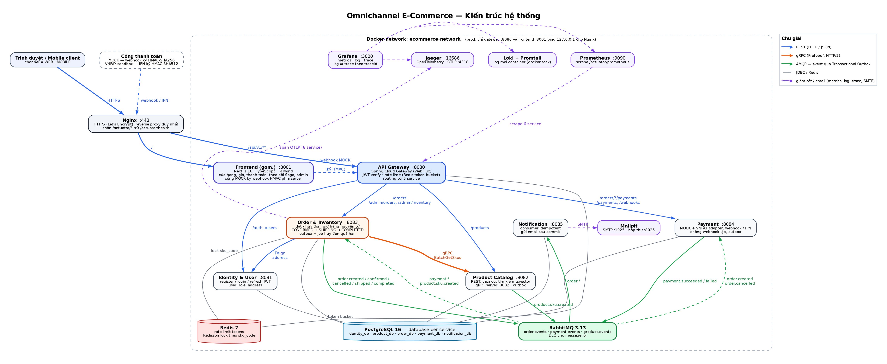

# Omnichannel E-Commerce

[](https://github.com/yuhd1907/omnichannel-ecommerce/actions/workflows/ci.yml)

Hệ thống thương mại điện tử đa kênh (Web / Mobile) theo kiến trúc **microservices**, viết bằng Java 17 + Spring Boot 4. Mỗi bounded context là một service với database riêng; client chỉ đi qua API Gateway. Các service phối hợp đặt hàng – thanh toán – thông báo bằng **Saga** qua RabbitMQ với **Transactional Outbox**.

**Bản chạy thật:** https://huyecommerce.duckdns.org (web **gom.**). VPS chỉ nhận kết nối từ Việt Nam do nhà cung cấp chặn quốc tế.

Repo chia hai phần: [`backend/`](backend/) (Gradle multi-module, 6 service Spring Boot) và [`frontend/`](frontend/) (Next.js). Hạ tầng chung (compose, Nginx, giám sát) ở gốc repo.



## Tài liệu

| Tài liệu | Nội dung |
| --- | --- |
| [docs/De_Tai_1_Omnichannel_ECommerce.md](docs/De_Tai_1_Omnichannel_ECommerce.md) | Đề tài gốc và tiêu chí đánh giá |
| [docs/Project_Overview.md](docs/Project_Overview.md) | **Tổng quan: đã làm được gì, chưa làm được gì** và hướng phát triển |
| [docs/DDD_DB_API_Contract.md](docs/DDD_DB_API_Contract.md) | Bounded context, schema từng database, API contract v1, luồng checkout và giữ hàng |
| [docs/api/](docs/api/) | OpenAPI 3.1 spec của 4 service (sinh từ code, xuất bằng `scripts/export-openapi.sh`) |
| [docs/Messaging_Topology.md](docs/Messaging_Topology.md) | RabbitMQ topology, DLQ, Outbox relay, consumer idempotent, hạn chế đã biết |
| [docs/Scope_Adjustments.md](docs/Scope_Adjustments.md) | Đối chiếu với đề bài và lý do điều chỉnh phạm vi |
| [docs/Flashsale_Results.md](docs/Flashsale_Results.md) | Thử nghiệm flash sale bằng k6 (100 người / 10 sản phẩm): cách chạy và kết quả |
| [docs/Demo_Script.md](docs/Demo_Script.md) | Kịch bản demo trực tiếp từng bước + câu hỏi thường gặp |
| [docs/deployment-notes.md](docs/deployment-notes.md) | Vận hành: deploy tự động, Nginx/HTTPS, giám sát, xử lý outbox `FAILED` và DLQ |
| [docs/erd/](docs/erd/) | ERD của từng database |

## Công nghệ

| Thành phần | Công nghệ |
| --- | --- |
| Ngôn ngữ / framework | Java 17, Spring Boot 4.1.1, Gradle 9.7.1 (multi-module) |
| API Gateway | Spring Cloud Gateway (WebFlux) 2025.1.3, rate limit bằng Redis |
| Giao tiếp đồng bộ | REST (JSON), OpenFeign, **gRPC** (Protobuf) |
| Giao tiếp bất đồng bộ | RabbitMQ 3.13, Transactional Outbox (publisher confirm, `FOR UPDATE SKIP LOCKED` cho nhiều instance), consumer idempotent, DLQ |
| Database | PostgreSQL 16, Flyway migration — database per service; tìm kiếm toàn văn bằng `tsvector` + `unaccent` |
| Cache / lock | Redis 7, Redisson (khóa phân tán theo `sku_code` khi giữ hàng) |
| Bảo mật | JWT (HS512, jjwt 0.13), RBAC `USER` / `ADMIN`, webhook ký HMAC-SHA256, VNPAY ký HMAC-SHA512, `Idempotency-Key` khi đặt hàng |
| Giám sát | Micrometer + Prometheus + Grafana (dashboard có sẵn); log tập trung **Loki + Promtail**; trace phân tán **OpenTelemetry → Jaeger** (`traceId` trả về trong mọi response, bấm từ log sang trace trong Grafana) |
| Frontend | Next.js 16 (App Router), TypeScript, Tailwind CSS v4, react-hook-form + zod, sonner, sweetalert2 |
| Email | SMTP (mặc định Mailpit; Gmail/Brevo khi đặt `SMTP_*` trong `.env`), email HTML, lưu trạng thái gửi và tự gửi lại khi lỗi (backoff, tối đa 5 lần) |
| Đóng gói / CI-CD | Docker multi-stage, Docker Compose, GitHub Actions (build + test Java và frontend) → GHCR (7 image), VPS tự kéo image |
| Kiểm thử | JUnit 5 + Mockito, smoke test end-to-end (`scripts/smoke-test.mjs`), k6 load test |

## Các service

| Service | Cổng | Database | Chức năng |
| --- | --- | --- | --- |
| `api-gateway` | 8080 | — | Định tuyến, xác thực JWT, rate limit |
| `identity-service` | 8081 | `identity_db` | Đăng ký, đăng nhập, refresh token, địa chỉ giao hàng |
| `product-service` | 8082 (REST), 9082 (gRPC) | `product_db` | Catalog, tìm kiếm toàn văn, quản trị sản phẩm, gRPC `GetSku` / `BatchGetSkus`, outbox `product.sku.created` |
| `order-service` | 8083 | `order_db` | Đặt / hủy đơn (`Idempotency-Key`), giữ hàng nguyên tử, vòng đời giao hàng, quản trị tồn kho, tự tạo dòng kho cho SKU mới, hủy đơn quá hạn |
| `payment-service` | 8084 | `payment_db` | Thanh toán khi nhận hàng (COD), VNPAY sandbox (IPN ký HMAC-SHA512), webhook có chữ ký, chống xử lý lặp |
| `notification-service` | 8085 | `notification_db` | Nhận event đơn hàng, lưu thông báo, gửi email |
| `frontend` | 3001 | — | Web **gom.**: cửa hàng, tìm kiếm, giỏ hàng, đặt hàng, thanh toán khi nhận hàng (COD) hoặc VNPAY (thẻ / VNPAY-QR), theo dõi Saga, quản trị đơn và tồn kho |

Module dùng chung trong `backend/`: `common` (envelope response kèm `traceId`, mã lỗi, JWT filter) và `grpc-api` (file `.proto` + stub sinh tự động).

**Luồng chính:** tạo đơn (`PENDING`, giữ hàng) → thanh toán → webhook `SUCCESS` → `CONFIRMED / PAID` → admin giao hàng `SHIPPING` → `COMPLETED`. Thanh toán thất bại hoặc quá 15 phút → `CANCELLED`, trả kho. Mỗi bước phát event và gửi email.

## Chạy toàn hệ thống bằng 1 lệnh

**Yêu cầu:** Docker Desktop (Compose ≥ v2.24) và **còn trống ≥ 6 GB RAM**. Không cần cài JDK vì code được build trong container.

```powershell
docker compose up -d --build --wait
```

Lệnh này build 7 image, khởi động 16 container và chỉ trả về khi tất cả đã sẵn sàng. Lần build đầu mất khoảng 5–10 phút để tải dependency. File `.env` **không bắt buộc**; muốn tùy chỉnh thì tạo từ mẫu `if (-not (Test-Path .env)) { Copy-Item .env.example .env }` (**không** chép đè lên `.env` đã có: mật khẩu PostgreSQL/RabbitMQ chỉ được đặt lúc tạo volume lần đầu, đổi trong `.env` sau đó sẽ làm service không đăng nhập được database).

| Địa chỉ | Nội dung |
| --- | --- |
| http://localhost:3001 | **Web (frontend)** — đăng ký tài khoản rồi mua hàng, thanh toán bằng cổng giả lập |
| http://localhost:8025 | Mailpit — hộp thư nhận email của hệ thống |
| http://localhost:3000 | Grafana (`admin` / `admin`) — dashboard "Omnichannel - Tổng quan" |
| http://localhost:9090 | Prometheus |
| http://localhost:16686 | Jaeger — trace một request qua gateway → order → identity / product (gRPC) |
| Grafana → Explore → Loki | Log của mọi container, lọc theo `service`, `level`; dòng có traceId mở thẳng trace trong Jaeger |
| http://localhost:15672 | RabbitMQ Management (`guest` / `guest`) |

Kiểm tra nhanh:

```powershell
docker compose ps
curl.exe -s http://localhost:8080/actuator/health                               # {"status":"UP",...}
curl.exe -s -o NUL -w "%{http_code}`n" http://localhost:8080/api/v1/products     # 200 (public)
curl.exe -s -o NUL -w "%{http_code}`n" http://localhost:8080/api/v1/orders       # 401 (cần JWT)
```

**VNPAY sandbox (tùy chọn):** đăng ký miễn phí tại https://sandbox.vnpayment.vn/devreg/, nhận TMN code + hash secret qua email, đặt vào `.env`:

```
VNPAY_TMN_CODE=...
VNPAY_HASH_SECRET=...
VNPAY_RETURN_URL=http://localhost:3001/payment/vnpay-return
```

Return URL trỏ về trang của frontend; trang này chuyển tham số cho `GET /api/v1/payments/vnpay/return` để kiểm chữ ký. Trên VPS thay `http://localhost:3001` bằng `https://<domain>`.

rồi `docker compose up -d payment-service`. Trên trang quản trị merchant sandbox, khai IPN URL `https://<domain>/api/v1/payments/vnpay/ipn` (chạy local thì VNPAY không gọi được IPN; return URL tự áp kết quả sau khi kiểm chữ ký). Không cấu hình thì chỉ dùng được MOCK.

Lệnh thường dùng:

```powershell
docker compose logs -f order-service     # xem log một service
docker compose up -d --build api-gateway # build lại một service sau khi sửa code
docker compose down                      # dừng, giữ dữ liệu
docker compose down -v                   # dừng và XÓA toàn bộ dữ liệu (volume)
```

## Kiểm thử

| Loại | Cách chạy |
| --- | --- |
| Unit test | `cd backend; $env:CI="true"; .\gradlew clean build` (`CI=true` bỏ qua test `@Tag("integration")` cần DB thật) |
| Frontend | `cd frontend; npm ci; npx tsc --noEmit; npm run lint; npm run build` |
| Smoke test end-to-end | `node scripts/smoke-test.mjs` (đăng ký → đặt hàng → gửi lại cùng `Idempotency-Key` → thanh toán → `CONFIRMED`, kiểm tra `403` admin). VPS: `$env:BASE="https://huyecommerce.duckdns.org"; node scripts/smoke-test.mjs` |
| Dấu vết Saga một đơn | `Get-Content scripts\sql\saga-check.sql \| docker exec -i ecommerce-postgres psql -U postgres -d order_db -v order_id=<UUID>` |
| Tính đúng khi tranh mua | [scripts/load-test/flashsale-k6.js](scripts/load-test/flashsale-k6.js) — 100 người / kho 10, kết quả ở [Flashsale_Results.md](docs/Flashsale_Results.md) |
| Thông lượng | [scripts/load-test/load-order-k6.js](scripts/load-test/load-order-k6.js) — 100 → 1000 req/s qua gateway, kiểm bảo toàn kho bằng `scripts/sql/load-verify.sql` (hướng dẫn ở đầu file) |

## Triển khai (prod)

```bash
docker compose -f docker-compose.yml -f docker-compose.prod.yml up -d --wait
```

[docker-compose.prod.yml](docker-compose.prod.yml) dùng image build sẵn trên GHCR và chỉ ghi đè phần cổng:

- `api-gateway` bind `127.0.0.1:8080`, `frontend` bind `127.0.0.1:3001`; **Nginx là reverse proxy duy nhất** nhận HTTPS từ Internet: `/api/v1/` vào gateway, còn lại vào frontend ([infra/nginx/omnichannel.conf](infra/nginx/omnichannel.conf)).
- 5 service ứng dụng không publish cổng nào; chúng gọi nhau qua mạng Docker bằng tên service.
- PostgreSQL, Redis, RabbitMQ, Mailpit, Prometheus, Grafana, Jaeger chỉ bind `127.0.0.1`, xem qua SSH tunnel; Loki và Promtail không mở cổng nào.

Lưu ý: `ufw` **không** chặn được cổng do Docker publish, vì Docker tự ghi luật iptables vượt qua ufw. Phải chặn ngay trong file compose như trên.

**CD:** merge vào `main` → GitHub Actions chạy test, build 7 image và push GHCR → cron trên VPS chạy [scripts/deploy/auto-deploy.sh](scripts/deploy/auto-deploy.sh) mỗi 2 phút, thấy code hoặc image mới thì `up -d`. Lý do không dùng SSH-push: [Scope_Adjustments.md](docs/Scope_Adjustments.md) mục 6.

## Chạy từng service khi phát triển

Chạy hạ tầng bằng Docker, chạy service cần sửa bằng IDE hoặc Gradle. Cần JDK 17.

```powershell
if (-not (Test-Path .env)) { Copy-Item .env.example .env }   # các *_HOST trong .env.example đã là localhost
docker compose up -d --wait postgres redis rabbitmq mailpit
cd backend
.\gradlew.bat :order-service:bootRun     # bootRun tự nạp biến từ ../.env
```

## Hạ tầng và thông tin kết nối

| Thành phần | Địa chỉ (từ máy host) | Tài khoản |
| --- | --- | --- |
| PostgreSQL | `localhost:5432` | user `postgres`, mật khẩu `POSTGRES_PASSWORD` trong `.env` (không có `.env` thì `123456!`) |
| Redis | `localhost:6379` | không mật khẩu |
| RabbitMQ | `localhost:5672`, UI `localhost:15672` | `RABBITMQ_DEFAULT_USER` / `RABBITMQ_DEFAULT_PASS` (mặc định `guest` / `guest`) |

```powershell
docker exec -it ecommerce-postgres psql -U postgres -d order_db
```

Năm database được tạo bởi [infra/postgres/init-databases.sql](infra/postgres/init-databases.sql). Script này **chỉ chạy khi volume còn trống**; schema từng database do Flyway quản lý trong `backend/<service>/src/main/resources/db/migration`.

## Cấu trúc thư mục

```
.
├── backend/                      # Gradle multi-module (Java 17, Spring Boot 4)
│   ├── api-gateway/              # Spring Cloud Gateway: route, JWT filter, rate limit
│   ├── identity-service/         # tài khoản, JWT, RBAC, địa chỉ
│   ├── product-service/          # REST + gRPC server, tìm kiếm tsvector, outbox relay
│   ├── order-service/            # Order & Inventory (chung order_db), outbox relay, hủy đơn quá hạn
│   ├── payment-service/          # COD + VNPAY sandbox, webhook / IPN, outbox relay
│   ├── notification-service/     # consumer RabbitMQ, gửi email
│   ├── common/                   # ApiResponse/ApiError (kèm traceId), ErrorCode, JWT filter dùng chung
│   ├── grpc-api/                 # product_internal.proto → stub Java
│   ├── build.gradle, settings.gradle, gradlew
├── frontend/                     # Next.js 16 + TypeScript + Tailwind (web gom.)
├── infra/
│   ├── nginx/                    # reverse proxy + HTTPS trên VPS
│   ├── postgres/                 # script tạo 5 database (database per service)
│   └── monitoring/               # Prometheus, Grafana (datasource + dashboard), Loki, Promtail
├── scripts/
│   ├── smoke-test.mjs            # kiểm thử end-to-end qua web, làm nóng trước demo
│   ├── export-openapi.sh         # xuất OpenAPI spec → docs/api/
│   ├── load-test/                # k6: flash sale 100 người / kho 10, thông lượng 1000 req/s
│   ├── sql/                      # reset / kiểm tra kho, dấu vết Saga của một đơn
│   └── deploy/                   # auto-deploy.sh (cron trên VPS kéo image GHCR)
├── docs/                         # đề tài, thiết kế DDD/API, OpenAPI spec, sơ đồ, kết quả load test, kịch bản demo
├── .github/workflows/            # ci.yml (test backend + frontend), docker.yml (build + push 7 image)
├── docker-compose.yml            # local: build từ backend/ và frontend/, mở cổng để debug
├── docker-compose.prod.yml       # prod: image GHCR, chỉ gateway + frontend cho Nginx
└── .env.example                  # dùng chung cho compose và Gradle bootRun
```
