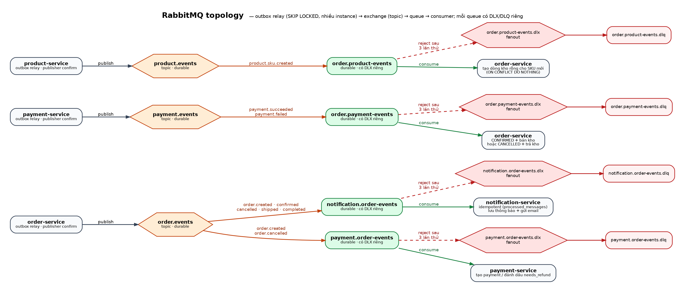

# RabbitMQ topology và Outbox

Thiết kế giao tiếp bất đồng bộ giữa các service. Bối cảnh tổng thể: [architecture.png](architecture.png); luồng nghiệp vụ: [DDD_DB_API_Contract.md](DDD_DB_API_Contract.md) mục 5.



*(Nguồn sơ đồ: [rabbitmq-topology.dot](rabbitmq-topology.dot).)*

## 1. Bảng topology

| Exchange (topic) | Routing key | Queue | DLX → DLQ | Consumer | Trạng thái |
| --- | --- | --- | --- | --- | --- |
| `order.events` | `order.created`, `order.confirmed`, `order.cancelled`, `order.shipped`, `order.completed` | `notification.order-events` | `notification.order-events.dlx` → `.dlq` | notification-service | ✅ |
| `order.events` | `order.created`, `order.cancelled` | `payment.order-events` | `payment.order-events.dlx` → `.dlq` | payment-service | ✅ |
| `payment.events` | `payment.succeeded`, `payment.failed` | `order.payment-events` | `order.payment-events.dlx` → `.dlq` | order-service | ✅ |
| `product.events` | `product.sku.created` | `order.product-events` | `order.product-events.dlx` → `.dlq` | order-service (tạo dòng kho rỗng cho SKU mới) | ✅ |

**Quy ước đặt tên**

- Exchange: `<bounded-context>.events`, kiểu `topic`, `durable`.
- Routing key: `<aggregate>.<sự kiện ở thì quá khứ>`, ví dụ `order.created`.
- Queue: `<service nhận>.<nội dung>`, `durable`. Mỗi service có queue riêng; hai service cùng nghe một event thì mỗi bên nhận một bản.
- Dead letter: `<queue>.dlx` (exchange) → `<queue>.dlq` (queue).

**Exchange và routing key là hợp đồng công khai** giữa các service; **queue là chi tiết riêng** của bên nhận.

## 2. Ai khai báo cái gì

| Service | Khai báo | Ghi chú |
| --- | --- | --- |
| order-service | exchange `order.events`; exchange `payment.events`, queue `order.payment-events` + binding (`payment.succeeded`, `payment.failed`), DLX + DLQ; exchange `product.events`, queue `order.product-events` + binding (`product.sku.created`), DLX + DLQ | bên phát `order.events`, bên nhận `payment.events` và `product.events` |
| notification-service | exchange `order.events`, queue `notification.order-events` + binding (`order.created`, `order.confirmed`, `order.cancelled`, `order.shipped`, `order.completed`), DLX + DLQ | khai báo lặp exchange để binding không lỗi khi khởi động trước bên phát. Relay của order publish với `mandatory`: routing key nào chưa có queue bind thì message bị return và event chuyển `FAILED`, nên **thêm event mới phải thêm binding ở đây** |
| payment-service | exchange `order.events`, queue `payment.order-events` + binding (`order.created`, `order.cancelled`), DLX + DLQ; exchange `payment.events` | bên nhận `order.events`, bên phát `payment.events` |
| product-service | exchange `product.events` | chỉ phát. Có outbox + relay riêng giống order/payment (`V4__create_outbox_events.sql`) |

Khai báo trùng một exchange ở cả hai bên là an toàn, vì RabbitMQ chấp nhận khai báo lặp nếu tham số giống nhau (`topic`, `durable=true`, `auto_delete=false`).

**Tham số queue không sửa được sau khi tạo.** Muốn thêm `x-dead-letter-exchange` cho một queue đã tồn tại thì lần khai báo sau sẽ lỗi `PRECONDITION_FAILED` và service không khởi động được. Cách duy nhất là xóa queue (mất message đang chờ) rồi khai báo lại. Vì vậy mọi queue đều có DLX ngay từ đầu.

**Khai báo `payment.order-events`.** Theo nguyên tắc "bên nhận khai báo queue", queue này do payment-service tạo khi cấu hình consumer. Mỗi queue đều được gắn kèm DLX (`payment.order-events.dlx`) và DLQ (`payment.order-events.dlq`).

## 3. Dead letter

- Mỗi queue có `x-dead-letter-exchange = <queue>.dlx`. DLX là exchange `fanout`, bind tới `<queue>.dlq`.
- **Vì sao fanout:** message bị dead-letter **giữ nguyên routing key gốc** (`order.created`). Nếu dùng DLX `direct` mà bind DLQ bằng key khác, message sẽ bị drop im lặng. DLX đã riêng cho từng queue nên fanout là đủ và không phụ thuộc routing key.
- DLQ không có consumer. Xem message bằng Management UI (http://localhost:15672 → Queues → `*.dlq` → *Get messages*); header `x-death` cho biết lý do (`rejected`) và số lần. Cách chuyển message về queue gốc xem [deployment-notes.md](deployment-notes.md).

## 4. Định dạng message

| Thuộc tính AMQP | Giá trị |
| --- | --- |
| body | `outbox_events.payload` nguyên dạng byte UTF-8 (JSON) |
| `content_type` | `application/json` |
| `message_id` | `outbox_events.id`. Consumer dùng giá trị này để chống xử lý trùng |
| `delivery_mode` | `2` (persistent) |
| `timestamp` | `outbox_events.created_at` |
| header `eventType` | `ORDER_CREATED`, `ORDER_CANCELLED`, `PAYMENT_SUCCEEDED`, `PRODUCT_SKU_CREATED`, … |
| header `aggregateId` | id của aggregate (đơn hàng / payment / sản phẩm) |

Payload `order.created`: `orderId`, `userId`, `channel`, `totalAmount`, `skus` (map `skuCode → quantity`). Payload `order.cancelled`: `orderId`, `userId`. Payload `product.sku.created`: `skuCode`, `productId`, `productName`, `price`. Thứ tự key có thể khác lúc ghi, vì PostgreSQL chuẩn hóa `jsonb`.

**Không dùng JSON converter ở bên phát.** Payload đã là JSON trong outbox; gửi byte giúp tránh hẳn vấn đề chuyển đổi Jackson 2/3 của các converter Spring AMQP trên Spring Boot 4. Bên nhận tự parse bằng `JsonMapper` của Jackson 3 (`tools.jackson.databind`).

## 5. Outbox relay (order-service, payment-service, product-service)

Ba service phát event dùng cùng một thiết kế relay. `OutboxRelay` chạy `@Scheduled(fixedDelay = 1000)`. Mỗi lượt **nhận** tối đa 50 event `PENDING` theo `created_at` (mục 5.1); với **từng event**: publish → chờ publisher confirm (tối đa 5 giây) → cập nhật trạng thái trong một transaction ngắn riêng. Không giữ transaction DB trong lúc chờ mạng.

| Kết quả publish | Xử lý |
| --- | --- |
| Broker ACK, không bị return | `markSent` → `SENT`, `published_at` |
| Broker NACK | `retry_count + 1` |
| Bị return (`mandatory`, không queue nào nhận routing key) | `retry_count + 1`. ACK của broker **không đủ**: message không vào queue nào vẫn được ACK |
| Hết 5 giây không có confirm | `retry_count + 1`, dừng batch (broker có thể đang treo) |
| Không mở được kết nối (broker chết) | **Giữ `PENDING`, không tăng retry**, dừng batch, lượt sau thử lại |
| `event_type` không có routing key | `retry_count + 1` → cuối cùng `FAILED` |

`retry_count` đạt 10 → `FAILED`, phải can thiệp tay (xem [deployment-notes.md](deployment-notes.md)).

**Vì sao broker chết không tính là retry:** relay chạy mỗi giây. Nếu tính, broker chết 10 giây sẽ đẩy toàn bộ event sang `FAILED` và phải sửa tay, trái với mục đích của outbox là để order-service tiếp tục nhận đơn khi broker chết.

Cấu hình bắt buộc (`order-service/application.yml`): `publisher-confirm-type: correlated`, `publisher-returns: true`, `template.mandatory: true`. Không có confirm thì `send()` thành công chỉ nghĩa là byte đã rời socket; broker sập ngay sau đó là mất event trong khi DB ghi `SENT`.

`management.health.rabbit.enabled: false` trong order/payment/product-service: broker chết không được làm service bị Docker đánh dấu unhealthy, vì lúc đó nó đang hoạt động đúng thiết kế.

### 5.1. Chạy nhiều instance: `FOR UPDATE SKIP LOCKED` + `locked_until`

Mỗi lượt relay nhận lô trong **một transaction ngắn**:

```sql
SELECT id FROM outbox_events
WHERE status = 'PENDING' AND (locked_until IS NULL OR locked_until < now())
ORDER BY created_at LIMIT 50
FOR UPDATE SKIP LOCKED;                       -- dòng instance khác đang khóa thì bỏ qua, không chờ
UPDATE outbox_events SET locked_until = now() + interval '60 seconds' WHERE id IN (...);
```

Commit xong mới publish (ngoài transaction, như cũ). Hai instance chạy cùng lúc nhận **hai lô khác nhau**: `SKIP LOCKED` tách nhau trong lúc transaction nhận lô còn mở, `locked_until` tách nhau sau khi đã commit.

| Tình huống | Xử lý |
| --- | --- |
| Broker chết giữa lô | `release`: đặt `locked_until = NULL` cho phần chưa gửi, lượt sau nhận lại ngay |
| Instance chết sau khi nhận lô | Hết 60 giây `locked_until` thì instance khác tự nhận lại, không kẹt |
| Instance chết sau publish, trước `markSent` | Gửi lại sau 60 giây → vẫn at-least-once, consumer phải idempotent (như trước) |

Đã kiểm chứng trên PostgreSQL 16 bằng hai phiên song song: hai phiên nhận hai tập id rời nhau (giao = 0), dòng có `locked_until` trong tương lai không bị nhận lại. Migration: order `V3__idempotency_keys_and_outbox_claim.sql`, payment `V3__outbox_claim.sql`, product `V4__create_outbox_events.sql`.

## 6. Consumer (notification-service)

- `@RabbitListener` trên `notification.order-events`, nhận `Message` thô.
- **Idempotent:** trong một transaction, `INSERT INTO processed_messages ... ON CONFLICT (message_id) DO NOTHING`. Được 0 dòng nghĩa là message trùng: log, ack, bỏ qua. Được 1 dòng thì ghi `notifications`. Hai bảng nằm trong cùng một transaction nên không thể có trạng thái "đã đánh dấu mà chưa gửi" hay "đã gửi mà chưa đánh dấu".
  - Không bắt unique violation: trên PostgreSQL, lỗi bất kỳ làm transaction chuyển sang *aborted*, và Spring đánh dấu rollback-only. Bắt exception rồi `return` vẫn nổ `UnexpectedRollbackException` lúc commit, khiến message trùng bị retry rồi vào DLQ.
- **Gửi email sau commit** (`TransactionSynchronization.afterCommit`) qua SMTP tới Mailpit. Commit lỗi thì không có thư "ma"; SMTP lỗi chỉ ghi log (`[EMAIL LỖI]`), không làm retry message. Địa chỉ nhận là `customerEmail` đi kèm payload mọi event `order.*`. Tắt bằng `MAIL_ENABLED=false` (chỉ ghi log `[EMAIL GIẢ LẬP]`).
  - Hạn chế: tiến trình chết đúng giữa commit và gửi thì mất thư đó (at-most-once cho email). Muốn chắc chắn cần outbox phía Notification.
- **Retry:** `retry.enabled: true`, `max-retries: 2` (tổng 3 lần), backoff 1s → 2s (tối đa 5s), `default-requeue-rejected: false`. Hết retry thì reject không requeue và message vào DLQ.
  - Spring Boot 4 dùng `max-retries` (số lần thử *lại*); key `max-attempts` cũ không còn và bị **bỏ qua im lặng**.
- **Message hỏng** (thiếu `message_id`, JSON sai, thiếu `orderId`/`userId`, routing key lạ): ném `AmqpRejectAndDontRequeueException` để vào DLQ ngay.
  - Retry interceptor của Spring AMQP 4 retry *mọi* exception, kể cả loại này. `RabbitListenerRetrySettingsCustomizer` loại trừ nó khỏi retry policy; policy khớp theo cả chuỗi cause nên lớp `ListenerExecutionFailedException` bọc ngoài vẫn khớp.

**Đã kiểm chứng trên stack Docker Compose (09/10/2026):**

| Kịch bản | Kết quả |
| --- | --- |
| 49 event PENDING tồn đọng khi relay khởi động | 49 `SENT`, 49 notification, `retry_count = 0` |
| Gửi lại message có `message_id` đã xử lý | log "Duplicate message, skip", không thêm notification, không vào DLQ |
| Payload `{not json` | vào DLQ trong < 0,7 giây, không backoff, nghĩa là không retry |
| Bảng `notifications` tạm không tồn tại | 1,5 giây vẫn chưa vào DLQ (đang backoff), 5,5 giây đã vào DLQ; `processed_messages` không có dòng (rollback) |
| Dừng RabbitMQ rồi tạo + hủy đơn | đơn tạo/hủy bình thường, health `UP`, 2 event `PENDING` với `retry_count = 0`; bật lại broker thì cả hai `SENT` và được tiêu thụ |

## 6.1. Consumer `order.product-events` (order-service)

`ProductEventListener` nhận `PRODUCT_SKU_CREATED` và chạy `INSERT INTO inventory (sku_code, 0, 0, 0) ON CONFLICT (sku_code) DO NOTHING`: SKU mới có sẵn dòng kho `available_qty = 0`, admin chỉ cần nhập số lượng. Idempotent tự nhiên (nhận lại event, hoặc admin đã nhập kho trước đó, đều không đổi dữ liệu) nên không cần bảng `processed_messages`. JSON hỏng / thiếu `skuCode` → DLQ ngay.

SKU có sẵn từ migration seed của product không sinh event; kho của 15 SKU mẫu được seed bằng `order-service/V4__seed_inventory_sample_skus.sql` (50 cái mỗi SKU, `ON CONFLICT DO NOTHING` nên không ghi đè kho đã có), `LOAD-001` do `scripts/load-reset.sql` quản lý.

## 7. Hạn chế đã biết

- **Thứ tự giữa các instance relay:** khi chạy nhiều instance, hai event của cùng một aggregate có thể nằm ở hai lô khác nhau và được gửi song song. Consumer hiện tại không phụ thuộc thứ tự (xem dòng dưới) nên chấp nhận được.
- **Outbox chỉ bảo đảm at-least-once**, kể cả khi chạy 1 instance: relay có thể sập sau khi broker ACK nhưng trước khi `markSent` commit, và lượt sau sẽ gửi lại. Mọi consumer vì vậy **bắt buộc idempotent** theo `message_id`.
- **Thứ tự không được bảo đảm tuyệt đối.** Event bị retry sẽ đi sau các event mới hơn trong cùng batch; consumer không được giả định `order.cancelled` luôn đến sau `order.created`.
- Retry của consumer là in-memory (stateless): luồng consumer bị chặn trong thời gian backoff (tối đa ~3 giây cho mỗi message lỗi). Chấp nhận được ở MVP.
